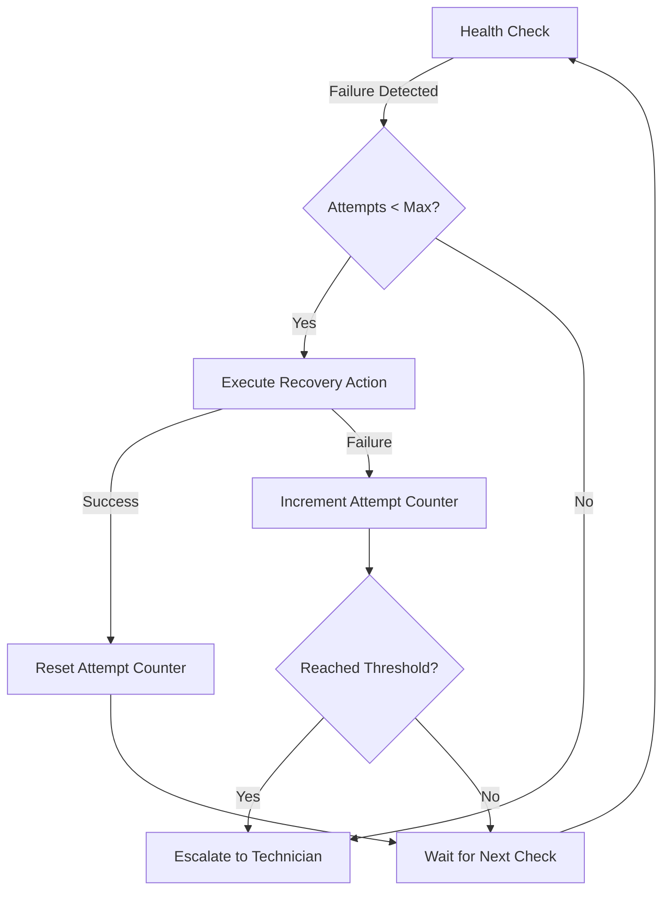

# IoT Self-Healing System

## Overview

The IoT Self-Healing System provides automated detection and recovery from common smart meter failure modes, reducing the need for manual technician intervention and improving overall system reliability.

## Features

### 1. Continuous Health Monitoring ✅

The system performs health checks every 30 seconds (configurable) to monitor:

- **MQTT Connectivity**: Ensures the MQTT broker connection is active and responsive
- **Memory Usage**: Tracks heap memory consumption and utilization percentage
- **Cache Health**: Monitors service cache size and detects potential corruption

Each health check produces a status report:
- `healthy`: System functioning normally
- `degraded`: System experiencing non-critical issues
- `critical`: System experiencing severe issues requiring immediate action

### 2. Common Failure Mode Detection ✅

The system automatically detects:

| Failure Mode | Detection Method | Threshold |
|-------------|------------------|-----------|
| MQTT Disconnection | Broker connectivity check | Connection lost |
| Memory Leak | Heap usage monitoring | > 512MB or > 80% utilization |
| Cache Corruption | Cache size monitoring | > 1000 entries |
| Service Unresponsive | Health check timeout | No response in check interval |

### 3. Automated Recovery Actions ✅

When a failure is detected, the system automatically attempts recovery:

#### MQTT Reconnection
```typescript
// Attempts to reconnect to the MQTT broker
// with a 5-second timeout
Action: reconnect_network
Target: mqtt
Timeout: 5000ms
```

#### Memory Cleanup
```typescript
// Forces garbage collection and clears internal caches
Action: clear_cache
Target: memory
Result: Immediate memory reclamation
```

#### Cache Clear
```typescript
// Clears the service cache to resolve corruption
Action: clear_cache
Target: service_cache
Result: Cache reset to empty state
```

### 4. Intelligent Escalation ✅

If automated recovery fails after **3 attempts**, the system escalates to the technician dashboard:

```
Escalation Criteria:
- 3 consecutive failed recovery attempts
- Issue marked as high severity
- Requires technician intervention flag set
```

Escalation includes:
- Detailed failure history
- All attempted recovery actions
- Current system state
- Recommended manual intervention steps

### 5. Comprehensive Audit Logging ✅

All self-healing activities are logged to the audit system:

#### Logged Events

| Event Type | Action ID | Metadata |
|-----------|-----------|----------|
| System Start | `self_healing_start` | Timestamp, configuration |
| System Stop | `self_healing_stop` | Timestamp |
| Recovery Attempt | `self_healing_recovery` | Issue, action, attempt number, outcome |
| Escalation | `self_healing_escalation` | Issue details, attempts, severity |
| Manual Reset | `self_healing_reset` | Issue key, timestamp |

#### Audit Log Example

```json
{
  "action": "self_healing_recovery",
  "userId": "system",
  "resource": "iot/mqtt_connectivity",
  "metadata": {
    "meterId": "system",
    "issue": "mqtt_connectivity",
    "action": {
      "type": "reconnect_network",
      "target": "mqtt",
      "timestamp": 1234567890,
      "success": true
    },
    "timestamp": 1234567890,
    "attemptNumber": 1,
    "outcome": "success"
  }
}
```

## Usage

### Starting the Self-Healing System

```typescript
import { startSelfHealing } from './iot/selfHealing.js';

// Start monitoring and automated recovery
startSelfHealing();
```

### Stopping the Self-Healing System

```typescript
import { stopSelfHealing } from './iot/selfHealing.js';

// Stop all monitoring
stopSelfHealing();
```

### Checking Health Status

```typescript
import { getHealthStatus } from './iot/selfHealing.js';

const healthChecks = getHealthStatus();
console.log(healthChecks);
// [
//   {
//     name: 'mqtt_connectivity',
//     status: 'healthy',
//     message: 'MQTT broker connected',
//     timestamp: 1234567890
//   },
//   ...
// ]
```

### Manual Recovery Reset

If a technician has manually resolved an issue, reset the attempt counter:

```typescript
import { resetRecoveryAttempts } from './iot/selfHealing.js';

// Reset attempts for MQTT connectivity issues
resetRecoveryAttempts('mqtt_connectivity:system');
```

### Checking Recovery Attempts

```typescript
import { getRecoveryAttempts } from './iot/selfHealing.js';

const attempts = getRecoveryAttempts('mqtt_connectivity:system');
console.log(`Recovery attempts: ${attempts}/3`);
```

## Configuration

Configure the self-healing system by modifying constants in `selfHealing.ts`:

```typescript
// Health check frequency
const HEALTH_CHECK_INTERVAL_MS = 30000; // 30 seconds

// Maximum automatic recovery attempts before escalation
const MAX_AUTO_RECOVERY_ATTEMPTS = 3;

// Threshold for escalation
const ESCALATION_THRESHOLD = 3;

// Memory threshold for critical alerts
const MEMORY_THRESHOLD_MB = 512;

// MQTT reconnection timeout
const MQTT_RECONNECT_TIMEOUT_MS = 5000;
```

## Integration with Existing Systems

### MQTT Client Integration

The self-healing system integrates with the existing MQTT client (`mqttClient.ts`):

- Uses `isMqttConnected()` to check connection status
- Uses `getMqttClient()` to trigger reconnection
- Leverages existing exponential backoff reconnection logic

### Audit System Integration

All recovery actions are logged via the audit system:

```typescript
import { recordAuditEvent } from '../lib/audit.js';

recordAuditEvent({
  action: 'self_healing_recovery',
  userId: 'system',
  resource: 'iot/mqtt_connectivity',
  metadata: { /* recovery details */ }
});
```

## Architecture

```
┌─────────────────────────────────────────┐
│      Self-Healing Orchestrator          │
│  (Continuous Health Check Scheduler)    │
└─────────────┬───────────────────────────┘
              │
              ├──► MQTT Health Check
              │     └──► Recovery: Reconnect
              │
              ├──► Memory Health Check
              │     └──► Recovery: Clear Cache, GC
              │
              └──► Cache Health Check
                    └──► Recovery: Clear Cache
                          │
                          ├──► Success: Reset Attempts
                          │
                          └──► Failure: Increment Attempts
                                 │
                                 └──► Threshold Reached
                                       └──► Escalate to Technician
```

## Recovery Flow



## Testing

### Run Tests

```bash
cd backend
npm test -- selfHealing.test.ts
```

### Test Coverage

The test suite covers:

- ✅ System startup and shutdown
- ✅ All health check scenarios (healthy, degraded, critical)
- ✅ All recovery actions (MQTT reconnect, memory cleanup, cache clear)
- ✅ Escalation after max attempts
- ✅ Recovery attempt tracking and reset
- ✅ Audit logging for all events
- ✅ Edge cases and error handling

### Example Test Run

```bash
$ npm test -- selfHealing.test.ts

 ✓ IoT Self-Healing System (125)
   ✓ startSelfHealing (4)
   ✓ stopSelfHealing (2)
   ✓ Health Checks (10)
   ✓ Recovery Actions (3)
   ✓ Escalation (2)
   ✓ Recovery Attempt Tracking (3)
   ✓ Audit Logging (2)
   ✓ getHealthStatus (2)

Test Files  1 passed (1)
Tests  28 passed (28)
```

## Monitoring and Observability

### Metrics to Monitor

1. **Health Check Success Rate**: Percentage of checks that pass
2. **Recovery Success Rate**: Percentage of recovery actions that succeed
3. **Escalation Rate**: Number of issues escalated per day
4. **Mean Time to Recovery (MTTR)**: Average time from failure detection to recovery
5. **Issue Recurrence Rate**: How often the same issue reoccurs

### Logs to Watch

All self-healing activities are logged with these markers:

```
INFO: Self-healing system started
DEBUG: Health check summary
WARN: Health check failed
INFO: Recovery attempt
INFO: Recovery successful
WARN: Recovery failed
ERROR: Escalating to technician
```

### Dashboard Integration

The system is designed to integrate with a technician dashboard that would display:

- Current health status of all meters
- Active recovery attempts in progress
- Escalated issues requiring intervention
- Historical recovery success rates
- System uptime and reliability metrics

## Troubleshooting

### Issue: Self-healing not starting

**Symptoms**: No health check logs appearing

**Resolution**:
```typescript
// Verify the system is started
startSelfHealing();

// Check logs for startup message
// Should see: "Starting IoT self-healing system"
```

### Issue: Continuous failed recoveries

**Symptoms**: Same issue repeatedly failing recovery

**Resolution**:
1. Check the underlying service is actually healthy
2. Verify recovery actions are appropriate for the issue
3. Consider manual intervention and reset attempts:
   ```typescript
   resetRecoveryAttempts('issue_key:meter_id');
   ```

### Issue: Memory usage still high after cleanup

**Symptoms**: Memory checks still critical after recovery

**Resolution**:
- Memory cleanup triggers garbage collection, but Node.js controls when GC runs
- Consider restarting the service manually for severe memory leaks
- Investigate root cause of memory growth

### Issue: MQTT reconnection timing out

**Symptoms**: MQTT recovery always fails with timeout error

**Resolution**:
1. Verify MQTT broker is actually reachable
2. Increase `MQTT_RECONNECT_TIMEOUT_MS` if network is slow
3. Check broker logs for connection rejections

## Future Enhancements

Potential improvements for future versions:

1. **Machine Learning Integration**: Predict failures before they occur based on historical patterns
2. **Dynamic Thresholds**: Adjust recovery thresholds based on meter behavior
3. **Smart Scheduling**: Schedule recovery actions during low-traffic periods
4. **Recovery Action Chaining**: Try multiple recovery strategies in sequence
5. **Technician Dashboard**: Real-time UI for monitoring and manual intervention
6. **SMS/Email Alerts**: Push notifications for escalated issues
7. **Meter-Specific Profiles**: Different recovery strategies per meter type
8. **Cluster-Wide Coordination**: Coordinate recovery across multiple backend instances

## References

- **Issue #853**: Offline meter detection
- **Issue #990**: Bidirectional meter support
- **Issue #1069**: Edge computing runtime connectivity handling
- **MQTT Client**: `backend/src/iot/mqttClient.ts`
- **Audit System**: `backend/src/lib/audit.ts`

## Support

For questions or issues with the self-healing system:

1. Check the audit logs for detailed recovery history
2. Review health status via `getHealthStatus()`
3. Consult this documentation for troubleshooting steps
4. If issues persist, escalate to the development team

---

**Last Updated**: 2025-07-15  
**Version**: 1.0.0  
**Maintainer**: IoT Systems Team
